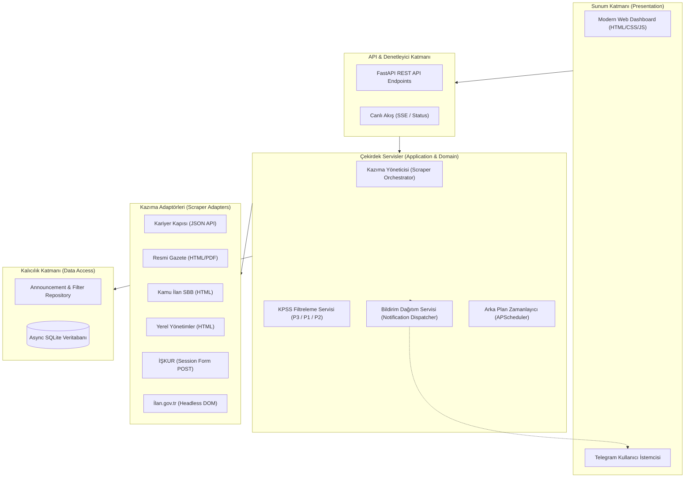

# Sistem Mimarisi (Architecture)

Bu doküman, sistemin uçtan uca mimarisini, katmanlarını, tasarım desenlerini ve asenkron veri akışını açıklar.

## 1. Mimari Genel Bakış (Layered Clean Architecture)

Sistem, iş kurallarının sunum katmanından ve dış araçlardan bağımsız olduğu **Clean / Onion Architecture** prensiplerine göre tasarlanmıştır:

## 2. Tasarım Desenleri (Design Patterns)

1. **Adapter Pattern (`core/scrapers/base_scraper.py`):**
   * Tüm kazıyıcılar ortak `BaseScraper` arayüzünü uygular: `async def scrape() -> List[AnnouncementDTO]`.
   * Her sitenin kendine has karmaşıklığı (JSON, HTML, ViewState) kendi adaptör sınıfı içinde hapsedilir.
2. **Factory / Registry Pattern (`core/scrapers/registry.py`):**
   * Sisteme yeni scraper sınıfları eklendiğinde tek bir satırla veya decorator ile kaydedilir.
   * Orkestratör tüm kayıtlı kazıyıcıları dinamik olarak çalıştırır.
3. **Repository Pattern (`infrastructure/database/repository.py`):**
   * SQL sorguları servis katmanına sızmaz.
   * `exists_by_hash()`, `save()`, `insert_new()`, `list_announcements()`, `get_unnotified_announcements()`, `mark_as_notified()` gibi temiz metodlarla yönetilir.
4. **Bildirim Akışı (olay yayıncısı YOK):**
   * Observer / olay sistemi uygulanmamıştır. `AnnouncementService` ilanları kaydettikten sonra `_notify_pending` ile bildirimleri doğrudan, `BaseNotifier` arayüzü üzerinden gönderir (bkz. [[notifications]]).
   * Yeni bir kanal eklemek için `BaseNotifier` uygulanır; olay yayıncısına ihtiyaç duyulursa ileride eklenebilir.
5. **Strategy (kural motoru) (`core/scoring/`):**
   * `KPSSScoreMatcher`, `ITFieldMatcher` ve `CityMatcher` sınıf metotlarıyla çalışan kural motorlarıdır (regex ve anahtar kelime tabanlı); ayrı strateji sınıf hiyerarşisi yoktur.

## 3. Asenkron & Eşzamanlı Çalışma Modeli

* **UI Asla Kilitlenmez:** Kazıma işlemleri `asyncio.gather` veya arka plan iş parçacığı havuzu (threadpool) ile eşzamanlı yürütülür.
* **Non-Blocking Veritabanı:** `aiosqlite` kullanılarak disk G/Ç (I/O) işlemleri asenkron event loop'u bloke etmez.
* **Arka Plan Servisi:** `APScheduler` belirlenen periyotlarda (örn. 15 dakikada bir) taramayı tetikler. Ayrıca Web arayüzünden istenildiği an "Şimdi Tara" butonuyla manuel tetikleme yapılabilir.

Bağlantılar: [[rules]], [[scrapers]], [[kpss_scoring]], [[notifications]]

## 4. Arama ve Etiket Depolama Notları
* **Türkçe duyarlı arama:** SQLite `LIKE` yalnızca ASCII için büyük/küçük harf duyarsızdır. Bu yüzden her kayıtta başlık+kurum+unvanın katlanmış hali `search_text` sütununda saklanır (`fold_turkish`: "MÜHENDİS" = "mühendis" = "muhendis"); sorgu da aynı şekilde katlanır.
* **Etiketler:** `field_tags` JSON'u `ensure_ascii=False` ile yazılır ve filtre `"Etiket"` biçiminde tırnaklı tam eşleşme yapar. Eski kaçışlı kayıtlar açılışta onarılır.
* **Hata kodları:** Alan istisnaları `http_status` taşır (DB 500, kazıyıcı/bildirim 502, doğrulama 422, çakışma 409). 5xx yanıtlarında ayrıntı istemciye sızdırılmaz.
* **Tek servis örneği:** API ve zamanlayıcı aynı `AnnouncementService` nesnesini paylaşır; tarama kilidi ve portal durumları tek yerde tutulur.
