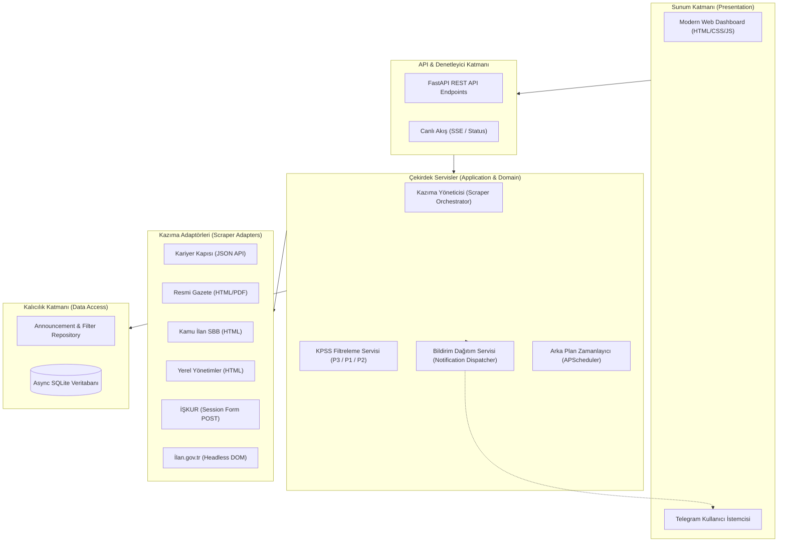

# Sistem Mimarisi (Architecture)

Bu doküman, sistemin uçtan uca mimarisini, katmanlarını, tasarım desenlerini ve asenkron veri akışını açıklar.

## 1. Mimari Genel Bakış (Layered Clean Architecture)

Sistem, iş kurallarının sunum katmanından ve dış araçlardan bağımsız olduğu **Clean / Onion Architecture** prensiplerine göre tasarlanmıştır:

## 2. Tasarım Desenleri (Design Patterns)

1. **Adapter Pattern (`core/scrapers/base_scraper.py`):**
   * Tüm kazıyıcılar ortak `BaseScraper` arayüzünü uygular: `async def scrape() -> List[AnnouncementDTO]`.
   * Her sitenin kendine has karmaşıklığı (JSON, HTML, ViewState) kendi adaptör sınıfı içinde hapsedilir.
2. **Factory / Registry Pattern (`core/scrapers/registry.py`):**
   * Sisteme yeni scraper sınıfları eklendiğinde tek bir satırla veya decorator ile kaydedilir.
   * Orkestratör tüm kayıtlı kazıyıcıları dinamik olarak çalıştırır.
3. **Repository Pattern (`infrastructure/database/repository.py`):**
   * SQL sorguları servis katmanına sızmaz.
   * `get_by_hash()`, `save_announcement()`, `list_announcements()`, `mark_notified()` gibi temiz metodlarla yönetilir.
4. **Observer / Event Publisher (`core/events/`):**
   * Yeni ilan bulunduğunda `AnnouncementCreatedEvent` yayınlanır.
   * Bildirim motoru ve loglama mekanizması bu olaya abone olur.
5. **Strategy Pattern (`core/scoring/strategy.py`):**
   * `P3ScoringStrategy`, `P1P2ScoringStrategy` sınıfları ilan başlık ve açıklamalarını regex ve ağırlıklandırma ile analiz eder.

## 3. Asenkron & Eşzamanlı Çalışma Modeli

* **UI Asla Kilitlenmez:** Kazıma işlemleri `asyncio.gather` veya arka plan iş parçacığı havuzu (threadpool) ile eşzamanlı yürütülür.
* **Non-Blocking Veritabanı:** `aiosqlite` kullanılarak disk G/Ç (I/O) işlemleri asenkron event loop'u bloke etmez.
* **Arka Plan Servisi:** `APScheduler` belirlenen periyotlarda (örn. 15 dakikada bir) taramayı tetikler. Ayrıca Web arayüzünden istenildiği an "Şimdi Tara" butonuyla manuel tetikleme yapılabilir.

Bağlantılar: [[rules]], [[scrapers]], [[kpss_scoring]], [[notifications]]
